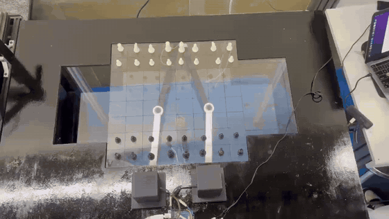
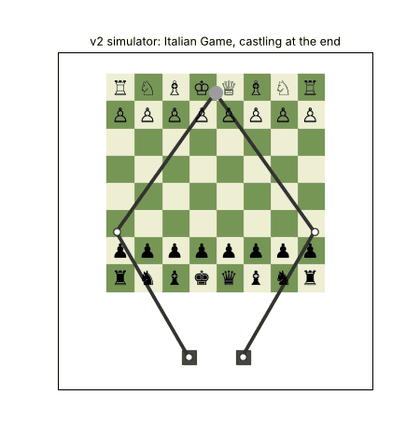
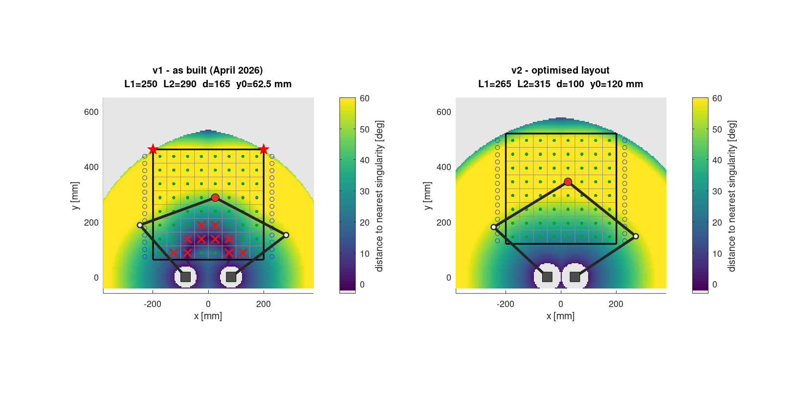
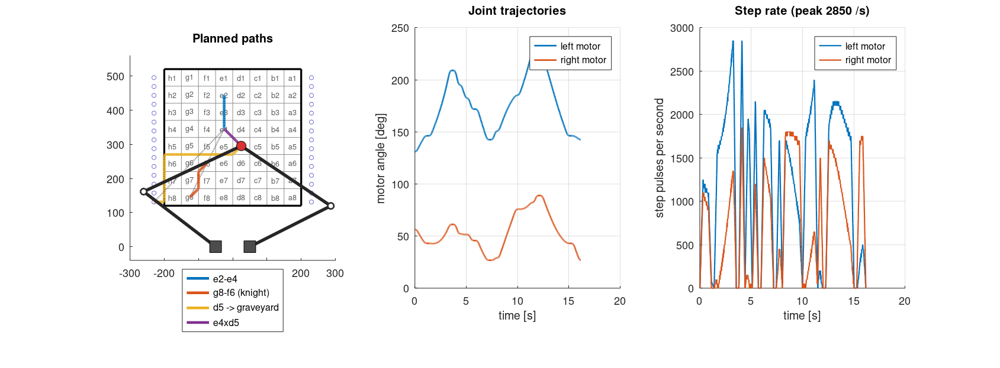
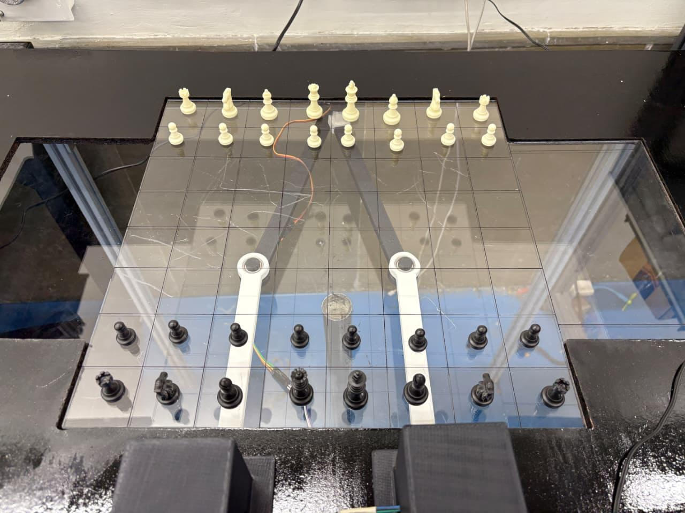
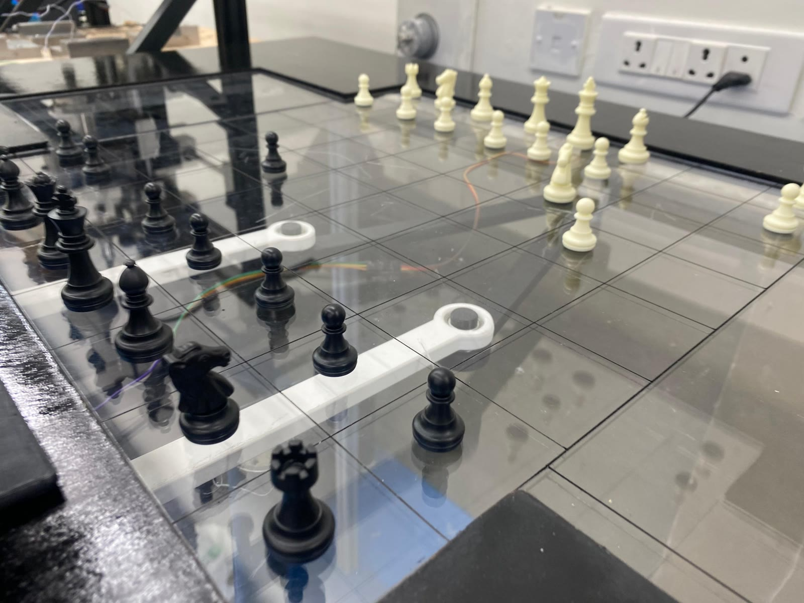
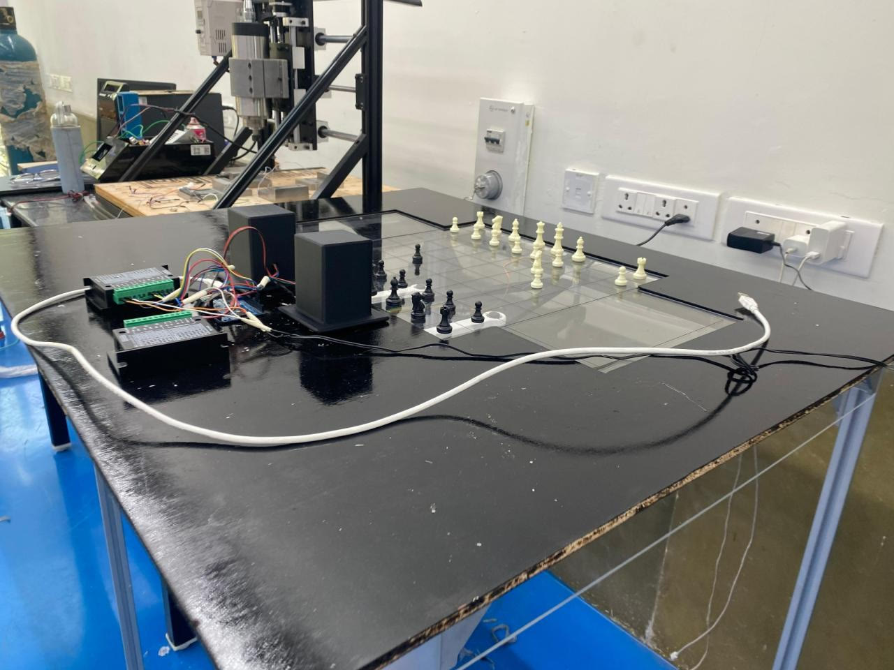
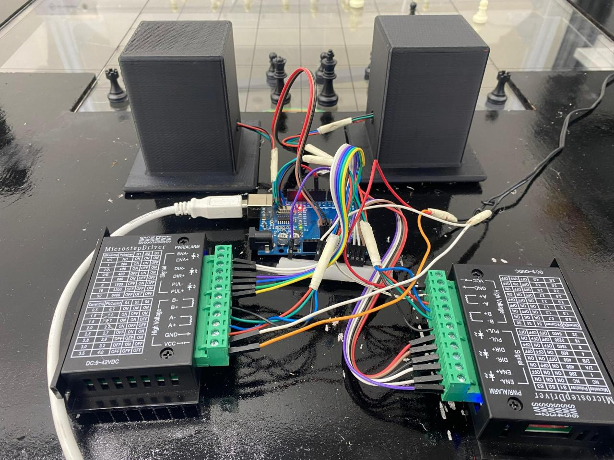
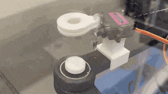
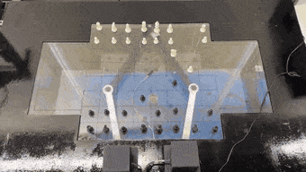

# 5-Bar Chess Robot

[](https://github.com/aamna-builds/5bar-chess-robot/actions/workflows/ci.yml)


A chess robot that moves pieces **without a gripper**. A magnet hidden under an acrylic board is driven by a **2-DOF planar 5-bar parallel linkage**, and each piece has a magnetic base, so it slides along on top.

| The real robot (v1, April 2026) | The v2 software playing a game in simulation |
|---|---|
|  |  |

## What's in this repository

The project was built and demonstrated in spring 2026 as the MEC308 (Mechanics of Machines) course project. Since then, the analysis has been taken further and **all of the software has been rewritten from scratch as v2**:

- **Analysis:** a [MATLAB toolbox](matlab/) that models the linkage, finds why the first build lost accuracy near the motors, and **optimises a new geometry**. The worst-case singularity margin goes from 0° to 21.8°.
- **Host software:** a [Python program](host/) with its own chess rules engine and a **collision-free path planner**:
  - knights and blocked pieces travel along the lanes between squares
  - captured pieces are parked in side graveyards
  - castling, en passant and promotion are all handled
  - an offline simulator shows the whole game
- **Firmware:** [Arduino firmware](firmware/) that does the inverse kinematics on board, **refuses any move near a singularity**, and drives both steppers along straight lines with a trapezoidal speed profile.
- **One config file:** [`config/robot.json`](config/robot.json) is shared by all three, and tests check that MATLAB, Python and the firmware agree on every square.
- **Documentation:** [journey](docs/journey.md), [hardware](docs/hardware.md) and [kinematics](docs/kinematics.md).

## Why v2



The colour shows how far each point is from a singularity:

- **Left (v1 as built):** the ranks next to the motors (red crosses) sit right on a *type-II* singularity. There, one microstep moves the magnet up to 1.4 mm, the torque needed shoots past even the gearbox rating, and the far corners (red stars) are just out of reach. This matches what testing showed: jerky or unpredictable motion near the motors, lost steps, and lower accuracy at the edges.
- **Right (v2):** slightly longer links, motors closer together and the board moved back by 57 mm put every square at least 27° away from trouble.

| | v1 | v2 |
|---|---|---|
| Squares within 20° of a singularity | 10 | **0** |
| Worst resolution | 1.4 mm / microstep | **0.08 mm** |
| Peak motor torque (assumed loads) | > 4.4 N·m | **0.5 N·m** |
| Captures, castling, promotion | by hand | **automatic** |
| Safety limits in firmware | none | **every move checked** |

The full comparison is in [docs/journey.md](docs/journey.md#6-v2-understanding-the-problems-then-fixing-them).

## Quick start

**MATLAB** (or GNU Octave):

```matlab
cd matlab
run_all        % runs the tests and regenerates every figure and table
```

**Simulate a game**, no hardware needed:

```bash
cd host
pip install -e ".[sim]"
python -m fivebar_chess replay --sim examples/special_moves.txt --gif game.gif
python -m fivebar_chess play --sim            # type moves like e2e4
```

**Play on the robot:**

1. Flash [`firmware/fivebar_chess`](firmware/) from the Arduino IDE.
2. Put the arms in the home pose and send `Z` (see [calibration](docs/hardware.md#calibration)).
3. Then run:

```bash
pip install -e ".[robot]"
python -m fivebar_chess play --port /dev/ttyUSB0                                  # two humans
python -m fivebar_chess play --port /dev/ttyUSB0 --engine /path/to/stockfish      # vs. engine
```

A chess engine is optional and runs as a separate program you install yourself. No engine code is part of this repository.

## How it works

```
 chess move ──► rules engine ──► planner ──────────────► firmware ─────────────► motors
  "g8f6"        legal? capture?   lanes, graveyard,       IK every 1 mm,          2 × NEMA 17
                castle? promo?    collision + IK check    safety check, steps     + 14:1 gearbox
```

- **Kinematics.** Each motor drives a two-link chain, and the chains meet at the magnet. The inverse kinematics is two applications of the cosine rule. The forward kinematics is the intersection of two circles. The Jacobian comes from the loop-closure constraints. → [docs/kinematics.md](docs/kinematics.md)
- **Singularities.** The robot watches two angles: the angle between the two distal links (*transmission*) and the angle at each elbow. Both must stay at least 20° away from 0° and 180°.
- **Paths.** A piece moves in a straight line if it clears every other piece by its own diameter plus 2 mm. Otherwise it follows the grid lines between squares, which always leave half a square of space.



## Repository layout

```
config/      robot.json (v2) and robot_v1.json (as built): the single source of truth
matlab/      kinematics, workspace and layout optimisation, torque, motion planning, figures/, output/
host/        Python package fivebar_chess: rules, planner, serial driver, simulator, tests
firmware/    Arduino sketch and PC unit tests
tools/       config header generator, build and test scripts
docs/        journey.md, hardware.md, kinematics.md
media/       photos, GIFs and videos of the build
```

## Build gallery

| | |
|---|---|
|  |  |
|  |  |
|  |  |

Videos: [final demo](media/videos/final-demo.mp4) · [top-down run 1](media/videos/top-down-run-1.mp4) · [top-down run 2](media/videos/top-down-run-2.mp4) · [magnet flip](media/videos/magnet-flip.mp4) · [workspace](media/videos/workspace.mp4) · [CAD assembly](media/videos/cad-assembly.mp4) · [v1 simulator](media/videos/v1-simulator.mp4)

## Status

| Part | State |
|---|---|
| v1 hardware | built and demonstrated in April 2026 |
| MATLAB analysis and v2 geometry | done, tested in CI |
| Host software | done, tested in CI (perft-verified rules, collision-checked planning) |
| Firmware | compiles for the Uno, unit-tested on a PC. Bench testing on the robot is next |
| v2 hardware | needs the new link lengths cut (265 / 315 mm) and the motors re-spaced to 100 mm |

The same software drives the original hardware with `--config config/robot_v1.json`.

## Background

This started as the course project for **MEC308 – Mechanics of Machines, Vibrations and Structures** (B.Tech Mechanical Engineering), under Prof. Ashitava Ghosal. It applies the course material directly: mechanism synthesis, Gruebler's DOF criterion, position and velocity analysis of closed-loop linkages, and torque estimates.

References: Norton, *Design of Machinery*; Uicker, Pennock & Shigley, *Theory of Machines and Mechanisms*; Craig, *Introduction to Robotics*; Merlet, *Parallel Robots*.

## License

[MIT](LICENSE) © 2026 Aamna Khan
