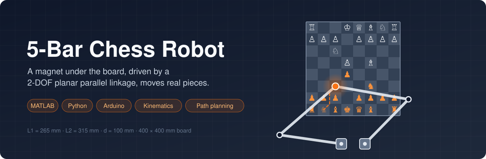
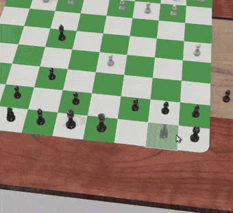
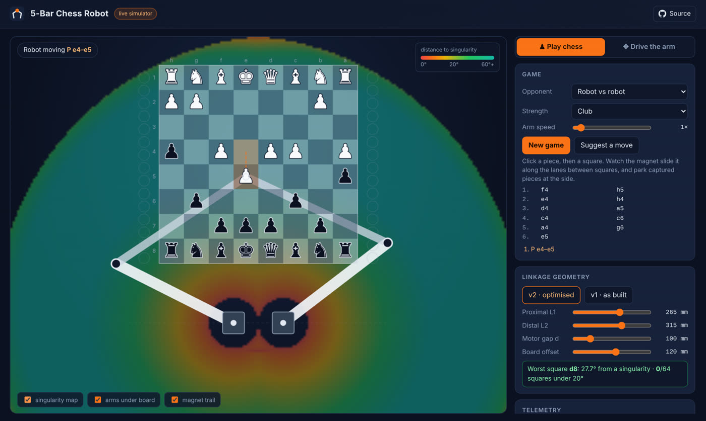
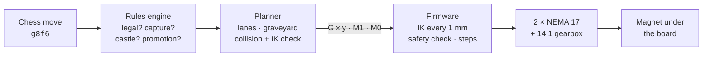

<p align="center">
  
</p>

<p align="center">
  <a href="https://github.com/aamna-builds/5bar-chess-robot/actions/workflows/ci.yml"></a>
  
  
  
  
</p>

<h3 align="center">
  <a href="https://aamna-builds.github.io/5bar-chess-robot/">▶ Play against the robot in your browser</a>
</h3>

<p align="center">
  <a href="#-demo">Demo</a> ·
  <a href="#-why-v2">Why v2</a> ·
  <a href="#-how-it-works">How it works</a> ·
  <a href="#-quick-start">Quick start</a> ·
  <a href="docs/journey.md">Journey</a> ·
  <a href="docs/hardware.md">Hardware</a> ·
  <a href="docs/kinematics.md">Kinematics</a>
</p>

---

A chess robot that moves pieces **without a gripper**. A magnet hidden under an acrylic board is driven by a **two-motor, five-bar parallel linkage**. Every piece has a magnetic base, so it glides across the board on top of the magnet.

The robot was built and demonstrated in April 2026. Since then, the analysis has been taken further and all of the software has been **rewritten from scratch as v2**:

<table>
<tr>
<td width="25%" valign="top">

**MATLAB toolbox**

Kinematics, singularity maps, layout optimisation, torque analysis and motion planning.
<br><a href="matlab/">matlab/</a>

</td>
<td width="25%" valign="top">

**Python host**

Its own chess rules engine, collision-free path planning, side graveyards and a simulator.
<br><a href="host/">host/</a>

</td>
<td width="25%" valign="top">

**Arduino firmware**

On-board inverse kinematics, a safety check on every move, and smooth coordinated stepping.
<br><a href="firmware/">firmware/</a>

</td>
<td width="25%" valign="top">

**Live simulator**

Play chess against the robot, drag the arm into singularities, and reshape the linkage, all in your browser.
<br><a href="https://aamna-builds.github.io/5bar-chess-robot/">open it</a> · <a href="simulation/">simulation/</a>

</td>
</tr>
</table>

# Demo

<table>
<tr>
<th width="50%">The real robot (v1, April 2026)</th>
<th width="50%">v2 software playing a full opening</th>
</tr>
<tr>
<td></td>
<td align="center"></td>
</tr>
<tr>
<td><sub>Pieces moved by the magnet under the board, with two geared NEMA 17 motors at the bottom.</sub></td>
<td><sub>The knight takes lanes between squares, captured pieces park at the sides, and castling moves the rook too.</sub></td>
</tr>
</table>

<table>
<tr>
<th>Magnet flip</th>
<th>Top-down run</th>
<th>CAD assembly</th>
</tr>
<tr>
<td></td>
<td></td>
<td></td>
</tr>
</table>

## Why v2

The first build worked, but it was jumpy near the motors and lost accuracy at the edges of the board. The MATLAB analysis found the cause.

<p align="center">
  
</p>

The colour shows how far each point is from a **singularity**, an arm pose where the linkage loses control.

- **v1:** the ranks next to the motors (✕) sit right on one. There, a single motor step moves the magnet up to 1.4 mm, and the far corners (★) are just out of reach.
- **v2:** slightly longer arms, motors closer together and the board moved back by 57 mm keep every square at least 27° away.

| | v1 as built | **v2** |
|---|:---:|:---:|
| Squares too close to a singularity | 10 / 64 | **0 / 64** |
| Worst positioning step | 1.4 mm | **0.08 mm** |
| Peak motor torque (estimated) | over 4.4 N·m | **0.5 N·m** |
| Captures · castling · promotion | by hand | **automatic** |
| Firmware safety limits | none | **every move checked** |

<sub>The full before-and-after is in <a href="docs/journey.md#6-v2-understanding-the-problems-then-fixing-them">the project journey</a>.</sub>

## Live simulator

<p align="center">
  <a href="https://aamna-builds.github.io/5bar-chess-robot/"></a>
</p>

The [browser simulator](https://aamna-builds.github.io/5bar-chess-robot/) runs the same kinematics, rules and path planner as the real robot:

- **Play chess:** play against the robot, two players, or let the robot play itself. The magnet routes every move, captured pieces park at the side, and each firmware command is listed as it would be sent.
- **Drive the arm:** drag the magnet around over a live singularity map. It stops at the red zones, just like the firmware.
- **Change the geometry:** switch between v1 and v2, or drag the link-length sliders, and watch the reachable area and the unsafe squares change.

Nothing is installed: it's a single page with no external libraries, and it's tested in CI alongside everything else.

## How it works



- **Kinematics:** each motor drives a two-link arm, and the two arms meet at the magnet. Going from position to motor angles is the cosine rule applied twice. → [kinematics.md](docs/kinematics.md)
- **Safety:** the robot watches the angle between the two outer links and the angle at each elbow. Both must stay at least 20° away from 0° and 180°, and the firmware refuses any move that breaks this.
- **Paths:** a piece moves in a straight line when it clears every other piece. Otherwise it follows the grid lines between squares, which always leave half a square of space.

<p align="center">
  
</p>

##  Quick start

<details open>
<summary><b>MATLAB / Octave</b>: regenerate every figure</summary>

```matlab
cd matlab
run_all
```
</details>

<details>
<summary><b>Simulator</b>: play without hardware</summary>

```bash
cd host
pip install -e ".[sim]"
python -m fivebar_chess play --sim                                       # type moves like e2e4
python -m fivebar_chess replay --sim examples/special_moves.txt --gif game.gif
```
</details>

<details>
<summary><b>Real robot</b></summary>

1. Flash [`firmware/fivebar_chess`](firmware/) from the Arduino IDE.
2. Put both arms in the home pose and send `Z` ([calibration](docs/hardware.md#calibration)).
3. Then run:

```bash
pip install -e "host[robot]"
python -m fivebar_chess play --port /dev/ttyUSB0                              # two players
python -m fivebar_chess play --port /dev/ttyUSB0 --engine /path/to/stockfish  # vs. an engine
```

A chess engine is optional and runs as a separate program you install yourself.
</details>

## Repository layout

```
config/     robot.json (v2) · robot_v1.json (as built): one config shared by everything
matlab/     analysis toolbox, figures/, output/
host/       Python package: rules, planner, serial driver, simulator, tests
firmware/   Arduino sketch + PC unit tests
simulation/ browser simulator (GitHub Pages) + Node tests
docs/       journey · hardware · kinematics
media/      photos, GIFs and videos of the build
tools/      config generator, build/test scripts, banner
```

## The build

<table>
<tr>
<td width="50%"></td>
<td width="50%"></td>
</tr>
<tr>
<td></td>
<td></td>
</tr>
</table>

<p align="center">
  <a href="media/videos/final-demo.mp4">Final demo</a> ·
  <a href="media/videos/top-down-run-1.mp4">Top-down run 1</a> ·
  <a href="media/videos/top-down-run-2.mp4">Top-down run 2</a> ·
  <a href="media/videos/magnet-flip.mp4">Magnet flip</a> ·
  <a href="media/videos/workspace.mp4">Workspace</a> ·
  <a href="media/videos/cad-assembly.mp4">CAD</a> ·
  <a href="media/videos/v1-simulator.mp4">v1 simulator</a>
</p>

The full story, from proposal to torque problems, redesign, demo and v2, is in [**docs/journey.md**](docs/journey.md).

## Status

| | |
|---|---|
| 🟢 v1 hardware | built and demonstrated, April 2026 |
| 🟢 MATLAB analysis + v2 geometry | done, tested in CI |
| 🟢 Host software | done, tested in CI |
| 🟡 Firmware | compiles for the Uno and passes PC tests; bench testing on the robot is next |
| ⚪ v2 hardware | needs the new 265 / 315 mm arms and the motors re-spaced to 100 mm |

The same software drives the original robot with `--config config/robot_v1.json`.

## Background

This started as the course project for **MEC308 – Mechanics of Machines, Vibrations and Structures** (B.Tech Mechanical Engineering), under Prof. Ashitava Ghosal. It applies the course material directly: mechanism synthesis, Gruebler's criterion, position and velocity analysis of closed-loop linkages, and torque sizing.

<sub>References: Norton, <i>Design of Machinery</i> · Uicker, Pennock &amp; Shigley, <i>Theory of Machines and Mechanisms</i> · Craig, <i>Introduction to Robotics</i> · Merlet, <i>Parallel Robots</i></sub>

---

<p align="center"><sub>MIT License · © 2026 Aamna Khan</sub></p>
