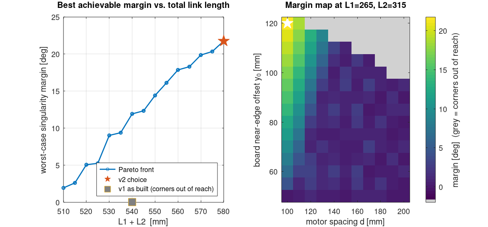

<sub>[← Back to README](../README.md) · [Journey](journey.md) · [Hardware](hardware.md) · [Kinematics](kinematics.md)</sub>

# Hardware

## Mechanism

```
   top view (board above, mechanism underneath)

        ┌──────────── 400 mm ────────────┐
        │  rank 1 (white)                │
        │                                │    ○ graveyard column, 15 slots
   ○    │                                │    ○ on each side for captured
   ○    │             ● magnet           │    ○ pieces
   ○    │            ╱ ╲                 │
        │   B1 ●────╱   ╲────● B2        │
        │       ╲  L2   L2  ╱            │
        │  rank 8 ╲(black) ╱             │
        └──────────╲──────╱──────────────┘
                L1  ╲    ╱  L1
                     ■  ■   motors (NEMA 17 + 14:1 planetary gearbox)
```

| | v1 as built | v2 |
|---|---|---|
| Proximal link L1 | 250 mm | 265 mm |
| Distal link L2 | 290 mm | 315 mm |
| Motor spacing d | ≈ 165 mm | 100 mm |
| Board near edge from motor axis | ≈ 62.5 mm | 120 mm |
| Board | 400 × 400 mm acrylic, 8 × 50 mm squares | same |
| Graveyard | none | 30 mm outside each side, 26 mm pitch |

The v2 numbers come out of [`matlab/optimize_layout.m`](../matlab/optimize_layout.m). The search had two constraints:

- the motor spacing must stay at least 100 mm, so the two gearbox housings still fit side by side
- L1 + L2 must stay at most 580 mm (no more than about 7 % longer than v1), so the inertia stays close to what v1 already handled



**Clearance:** the elbows swing slightly behind the motor axis on the near ranks (down to y ≈ −190 mm on v2). The frame must leave that area open.

## Parts

| Part | Spec | Qty |
|---|---|---|
| Stepper motor | NEMA 17 with planetary gearbox, 45 kg·cm rated | 2 |
| Driver | TB6600 microstep driver, 9–42 V | 2 |
| Controller | Arduino Uno | 1 |
| Magnet actuator | micro servo (SG90 / MG90S class) | 1 |
| Magnets | round neodymium magnets: one in the carriage, one in each piece cap | 1 + 32 |
| Logic level converter | 8-channel | 1 |
| Links | 4 mm acrylic (distal) and printed proximal arms, bearings at all five joints | 4 |
| Board | 4 mm clear acrylic, laser-engraved grid | 1 |
| Support layer | acrylic sheet under the links, so they do not sag | 1 |
| Frame | aluminium extrusion and a wooden platform (100 × 85 cm) | 1 |
| Power | 24 V supply for the drivers; USB for the Uno | 1 |

v1 cost was about ₹9,600 over five invoices (motors, drivers, magnets, servo, cables, converter and paint). The motor and driver kit was most of that. A batch of reed switches was bought for piece detection, but they were not used in the final build.

## Wiring

| Signal | Uno pin | TB6600 |
|---|---|---|
| Left STEP | D6 | PUL+ (PUL− to GND) |
| Left DIR | D5 | DIR+ (DIR− to GND) |
| Right STEP | D3 | PUL+ |
| Right DIR | D2 | DIR+ |
| Enable (optional) | not wired by default (`pins.enable = -1`) | ENA+ |
| Magnet servo | D10 | servo signal, 5 V supply |

Pins are set in [`config/robot.json`](../config/robot.json). After changing them, run `python3 tools/gen_firmware_config.py` to update `firmware/fivebar_chess/config.h`.

**Driver DIP switches (v2):**

- **Microstepping:** set 8 (1600 pulses/rev).
- **Current:** set to the motor's rated current.

v1 used 32 microsteps (6400 pulses/rev). That rate cannot be sustained by a software-timed Uno at useful speeds; see [`torque_and_speed.png`](../matlab/figures/torque_and_speed.png).

## Magnet carriage

The effector carries a permanent magnet on a micro-servo horn:

- `M1` turns the horn so the magnet faces the underside of the board, and the piece above couples to it.
- `M0` turns it away, so the carriage can travel under other pieces without dragging them.

Magnet strength is a trade-off. Too strong and it pulls neighbouring pieces along; too weak and the piece is left behind. Tune it with the piece caps and the board thickness.

## Calibration

1. Before switching on, move both proximal arms by hand to the **home pose**. On v2 this is 120° (left) and 60° (right), each arm 30° outward from straight ahead. A printed 30° jig makes it repeatable.
2. Power up, then send `Z`. The firmware refuses to move until it has been zeroed.
3. Run `python -m fivebar_chess goto e4 --port <port>` and a few more squares. If the magnet is offset by the same amount everywhere, adjust `board.near_edge_y_mm`. If it is rotated, check `home_deg`.
4. [`matlab/output/square_table.csv`](../matlab/output/square_table.csv) lists the exact angles and step counts for every square, for checking by hand.
