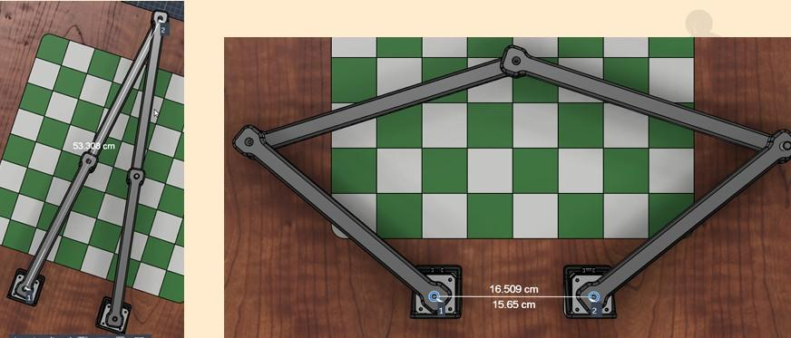
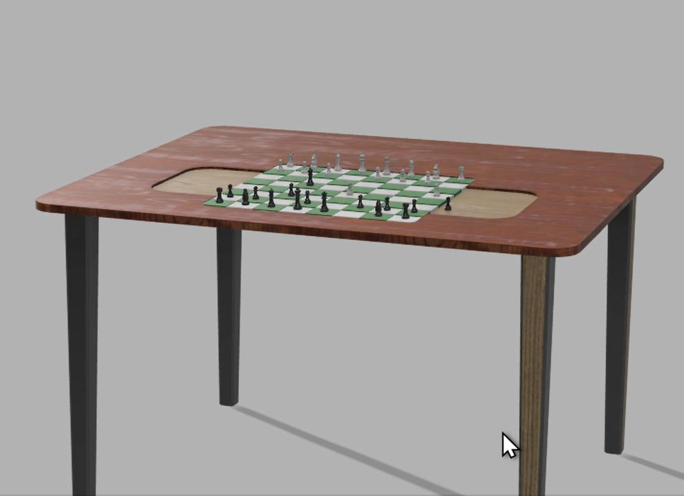
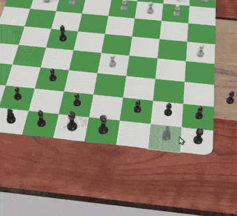
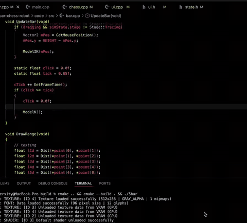
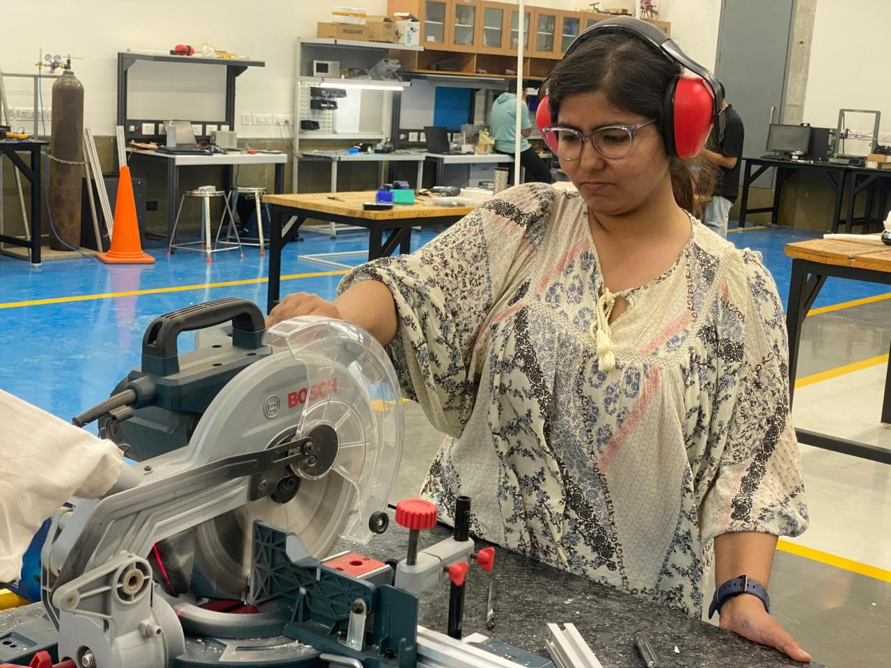
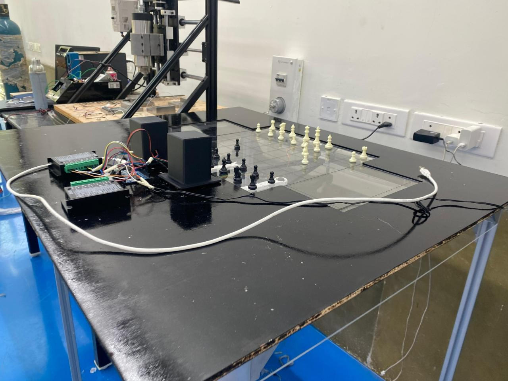
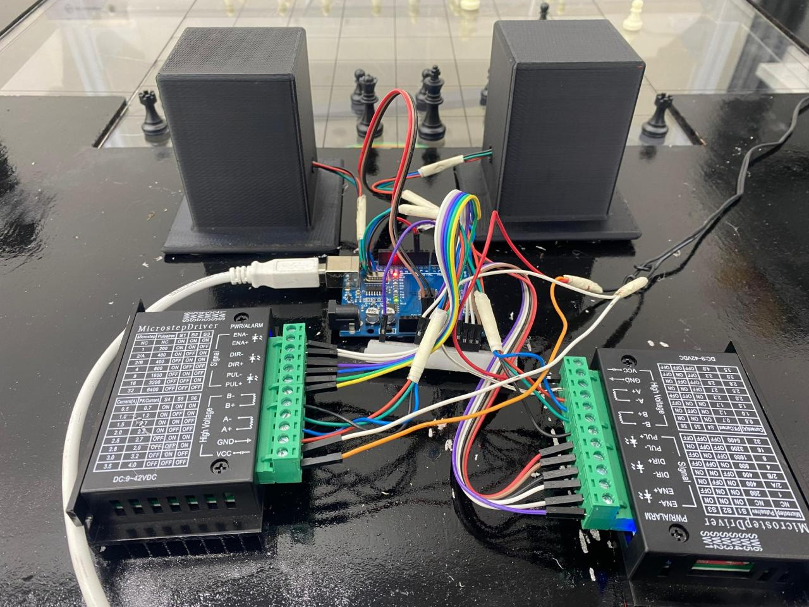
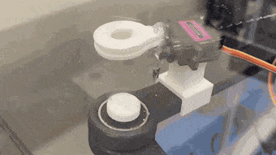
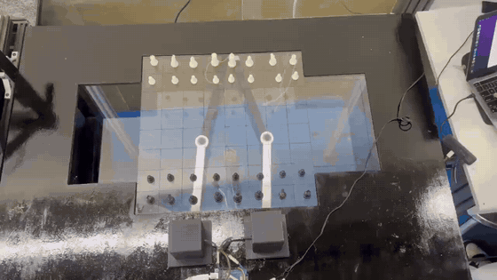
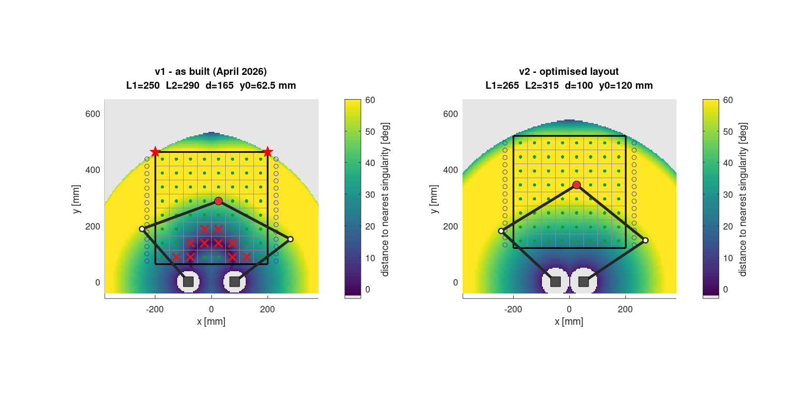

<sub>[← Back to README](../README.md) · [Journey](journey.md) · [Hardware](hardware.md) · [Kinematics](kinematics.md)</sub>

# Project journey

The robot was built as the course project for **MEC308 – Mechanics of Machines, Vibrations and Structures** (B.Tech Mechanical Engineering) between January and April 2026. After the final demonstration the whole software stack was rewritten and the geometry re-optimised; that rewrite is v2, the version in this repository.

```
 Jan 12 ─── Proposal & scope
 Jan 14 ─── Literature review: 5-bar vs Cartesian
 Jan 22 ─── Mechanism study & concept
 Jan 29 ─── DOF analysis, linkage geometry
 Feb 06 ─── Workspace & accuracy analysis
 Feb 16 ─── CAD of linkage and base
 Mar 01 ─── Kinematic simulation (v1 simulator)
 Mar 08 ─── Fabrication ── motors arrive damaged, replaced
 Mar 16 ─── Assembly ───── torque problem → board and links downsized
 Mar 23 ─── Calibration & pick-and-place testing
 Apr 01 ─── Performance evaluation
 Apr 08 ─── Documentation, final demonstration
 Apr 20 ─── Final report submitted
 after  ─── v2: analysis, re-optimised geometry, new software (this repo)
```

## 1. The idea: move pieces without a gripper

Robot arms that play chess usually need a gripper and a vertical axis on top of a multi-joint arm, which brings more weight, more joints and more to control. This project slides the pieces instead. A magnet under the board is moved by a **planar 5-bar parallel linkage**, and each piece has a magnetic base, so it follows the magnet across the board.

The 5-bar was chosen over a Cartesian (x–y gantry) machine for three reasons:

- **Fixed-base actuation:** both motors sit on the ground, so the moving parts are light.
- **Closed-loop stiffness:** two chains share the load, and errors do not stack up the way they do along a serial arm.
- **Mechanical simplicity:** two motors and five revolute joints, with no rails or belts.

The first proposal also kept a separate Z axis (a micro-servo or linear guide) and considered an electromagnet or a mechanical gripper. Both ideas were dropped in favour of the simpler magnetic slide.

## 2. Analysis and CAD (Jan – Feb)

- **DOF:** Gruebler's equation gives 3(5−1) − 2·5 = 2, so two motors control x and y exactly. See [kinematics.md](kinematics.md).
- **Workspace and accuracy:** the reachable area, dead zones, error sources (link-length errors, joint clearance and backlash, motor resolution) and collision checks for an 8×8 board.
- **CAD:** the NEMA 17 motors, chess pieces, brackets, the link-to-actuator and ground-to-link joints, and the table assembly.

| CAD link geometry | Table concept |
|---|---|
|  |  |

<p align="center"></p>

## 3. First simulator (Mar)

Before anything was cut, a desktop simulator (C++ with raylib) drew the linkage on a chessboard. It solved the inverse kinematics while the effector was dragged around, and could play moves from a chess engine. The motor angles it computed were streamed over serial to the Arduino.

<p align="center"></p>

## 4. Fabrication and the torque problem (Mar)

The parts were made and assembled as follows:

- **Links:** cut to length.
- **Board:** the acrylic workspace was laser-cut.
- **Frame:** a frame was cut from aluminium extrusion and topped with a 100 × 85 cm wooden platform.

<p align="center"></p>

Two setbacks followed:

1. **The first motors arrived damaged** and had to be exchanged, which delayed motor testing.
2. **The motors could not deliver enough torque.** The first design used a 440 mm board with longer links. The torque estimate assumed ideal motors, ignoring the 70–80 % real efficiency, and the longer links increased the moment arm. Upgrading to motors costing about ₹5,000 each would have broken the budget.

**Decision:** shrink the board to 400 × 400 mm and shorten the links, and add a planetary gearbox to the NEMA 17s (45 kg·cm rated). Downsizing was cheaper and more efficient than buying bigger motors. The project's buffer week absorbed the re-fabrication, so the final deadline did not move.

## 5. The as-built robot (April 2026)

| | |
|---|---|
| Mechanism | 5-bar planar parallel linkage, elbows-out |
| Links (v1) | proximal 250 mm, distal 290 mm, motor spacing about 165 mm |
| Board | 400 × 400 mm acrylic, 50 mm squares |
| Motors | 2 × NEMA 17 with planetary gearbox (45 kg·cm) |
| Drivers | 2 × TB6600, 6400 pulses/rev |
| Controller | Arduino Uno |
| Pick-up | permanent magnet flipped by a micro servo; pieces with magnetic caps |
| Frame | aluminium extrusion and a 100 × 85 cm wooden platform, with an acrylic support layer under the links |

| Full setup | Electronics |
|---|---|
|  |  |

| Magnet flip | Final demonstration |
|---|---|
|  |  |

The full videos are in [`media/videos`](../media/videos).

### What went wrong, and what was learned

| Area | Problem seen |
|---|---|
| Mechanical | joint misalignment caused jerky motion; acrylic links bent under load; backlash in the joints; full-board coverage was hard |
| Electrical | torque limits; TB6600 current tuning; keeping the two motors in sync; missed steps |
| Software | inverse kinematics; mapping squares to angles; smooth motion |
| Fabrication | laser-cut tolerances; errors stacking up in assembly; magnet strength (too strong lifted two pieces, too weak dropped them) |
| Testing | repeatability; small placement errors; vibration on long moves |

The report lists these limitations:

- no feedback
- reduced accuracy at the edge of the board
- step loss from timing delays
- a board that was not rigid enough

## 6. v2: understanding the problems, then fixing them

The analysis in [`matlab/`](../matlab) found a common cause for most of the motion problems. In the v1 layout:

- The ranks nearest the motors sit next to a **type-II singularity**. Square c8 is 0.4° from it.
- There, a single microstep moves the magnet by up to 1.4 mm.
- The torque needed to push a piece in the weak direction exceeds even the gearbox rating.
- The two far board corners are slightly out of reach.



v2 keeps the same motors, drivers, board and magnet, and changes the rest:

| | v1 (as built) | v2 (this repo) |
|---|---|---|
| Links L1 / L2 | 250 / 290 mm | **265 / 315 mm** (re-cut, +7 %) |
| Motor spacing | 165 mm | **100 mm** |
| Board offset from motors | 62.5 mm | **120 mm** |
| Worst singularity margin over the travel area | ≈ 0° (corners out of reach) | **21.8°** |
| Squares inside a 20° margin | 54 / 64 | **64 / 64** |
| Worst resolution | 1.4 mm / microstep | **0.08 mm / microstep** |
| Peak torque, assumed loads | > 4.4 N·m on ranks 7–8 | **0.5 N·m** everywhere |
| Microstepping | 32× (up to 38 k steps/s at 120 mm/s) | **8×** (≤ 8 k steps/s, easy for an Uno) |
| Captured pieces | removed by hand | **15-slot graveyard on each side**, routed automatically |
| Path planning | straight lines | **lanes between squares** for knights and blocked paths, with collision checks |
| Chess rules | external engine required | **built-in rules engine** (castling, en passant, promotion), engine optional |
| Firmware | streams raw angles, no limits | **IK on the Arduino**, safety check before every move, trapezoidal speed profile |
| Tests | none | MATLAB, Python and firmware tests in CI, cross-checked against each other |

Status: the v2 software is complete and tested in simulation. The v2 link lengths still need to be cut and fitted before it runs on the real robot. Until then, `config/robot_v1.json` drives the existing hardware with the same software.
