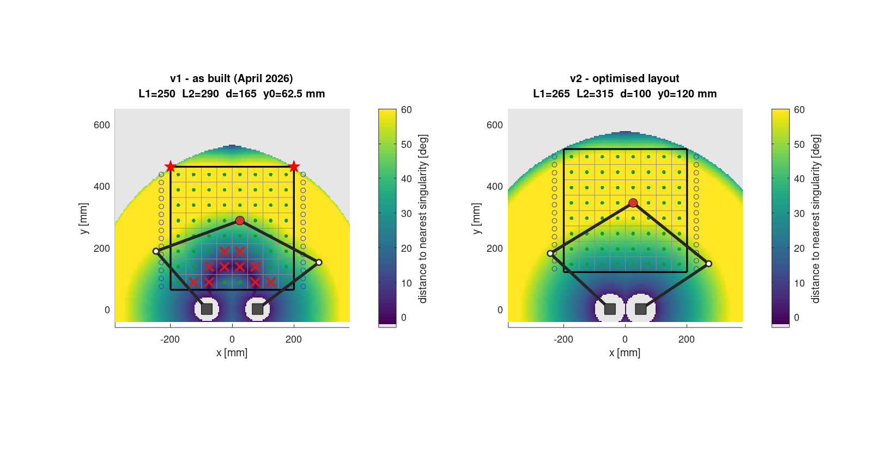
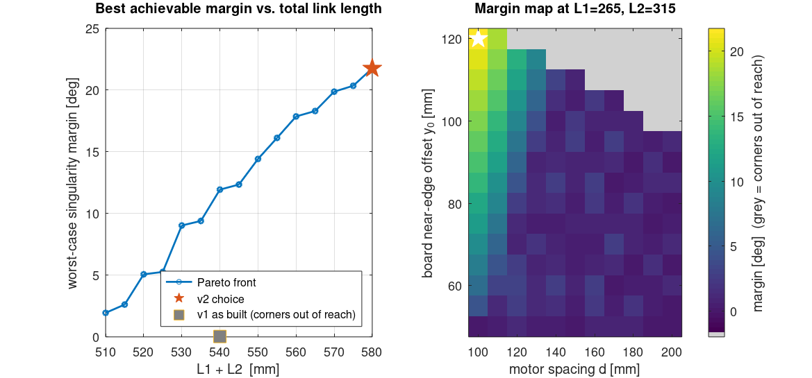
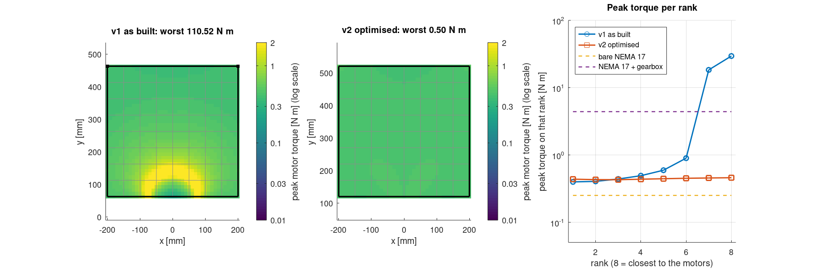
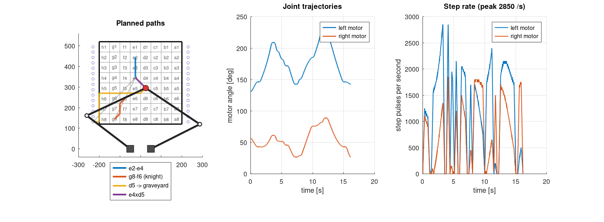
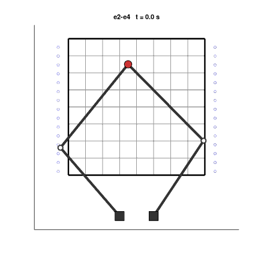

<sub>[← Back to README](../README.md)</sub>

# MATLAB toolbox

The analysis and design work for the robot. It runs unchanged in **MATLAB (R2019b or later)** and **GNU Octave 7 or later**. Every figure and table in this folder was produced by these scripts.

```matlab
>> cd matlab
>> run_all          % tests + every analysis; rewrites figures/ and output/
```

```bash
octave --no-gui --eval "run_all"      # headless; needs the Octave 'image' package for the GIF
```

The console output of the last run is in [`output/run_log.txt`](output/run_log.txt).

## Scripts

| Script | What it does | Output |
|---|---|---|
| `run_tests.m` | FK(IK(p)) = p over the whole travel area; the analytic Jacobian matches finite differences; every square and graveyard slot is safe; board orientation; trajectory end conditions; home pose is safe | console |
| `analyze_workspace.m` | Reachable area and distance to both singularity types, v1 vs v2. Lists squares outside the limits, resolution per microstep and the elbow sweep envelope | `figures/workspace_v1_vs_v2.png` |
| `optimize_layout.m` | Grid search over L1, L2, motor spacing and board offset (about 11,000 feasible layouts) for the largest worst-case singularity margin | `figures/layout_optimisation.png`, `output/layout_sweep.csv` |
| `torque_analysis.m` | Worst-case motor torque (Jacobian transpose and inertia) and step-rate demand. The load assumptions are at the top of the file | `figures/torque_and_speed.png` |
| `motion_demo.m` | Plans e2-e4, a knight move along the lanes, a capture to the graveyard, and the travel moves between them. Checks every sample against the limits and animates the result | `figures/motion_demo.png`, `figures/motion_demo.gif` |
| `export_tables.m` | Angles and step targets for all 64 squares and 30 graveyard slots | `output/square_table.csv` |

## Functions

| Function | |
|---|---|
| `fb_params` | load `config/robot.json` (or `robot_v1.json`) |
| `fb_ik`, `fb_fk`, `fb_elbows` | inverse and forward kinematics |
| `fb_jacobian` | velocity Jacobian, from the loop-closure constraints |
| `fb_angles`, `fb_quality`, `fb_min_margin` | transmission and elbow angles, margin, dexterity, resolution |
| `fb_square`, `fb_board_squares`, `fb_graveyard`, `fb_travel_points` | board layout |
| `fb_lane_route`, `fb_park_route`, `fb_trajectory` | path planning and trapezoidal time scaling |
| `fb_draw`, `fb_draw_board`, `fb_save`, `fb_gif_append`, `fb_cmap` | plotting helpers |

`square_table.csv` is also read by the Python tests and by the firmware's PC tests. All three implementations have to agree on every square.

## Results






<p align="center"></p>
